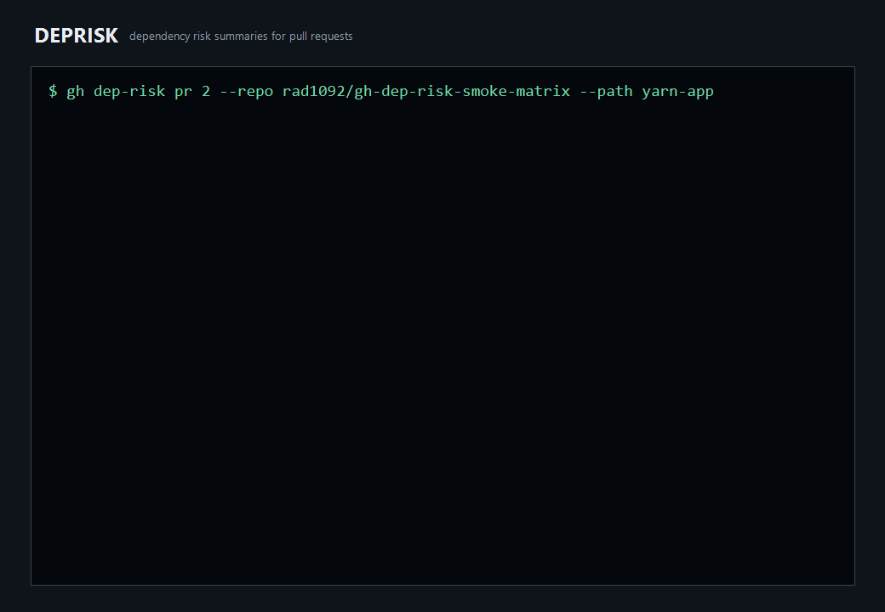

# gh-dep-risk

[](https://github.com/rad1092/gh-dep-risk/actions/workflows/test.yml)
[](https://github.com/rad1092/gh-dep-risk/actions/workflows/install-smoke.yml)

Give it a pull request number. It reads the dependency changes, scores each
one, and tells the reviewer the three things to check first.



```text
$ gh dep-risk pr 123
Repository: owner/repo
PR: #123 Update dependencies
Score: 48 (high), from left-pad
...

Check first:
1. left-pad@2.0.0 runs a script when it is installed. Read it before installing: npm view left-pad@2.0.0 scripts
2. left-pad@2.0.0 was published in the last 7 days. If the update isn't urgent, wait a few days before merging.
3. left-pad moves from 1.0.0 to 2.0.0. Read the release notes for breaking changes.
...

Targets:
- root [root, ecosystem=npm] score=48 (high), blast=medium
  left-pad 1.0.0 -> 2.0.0 [updated/runtime] score=48 (10 major version bump + 18 recently published version + 20 install script)
```

Full reports: [human](docs/examples/single-target-human.txt),
[Markdown comment](docs/examples/multi-target.md),
[JSON](docs/examples/multi-target.json).

## Install

```bash
gh auth login
gh extension install rad1092/gh-dep-risk
gh extension upgrade dep-risk   # later
```

## Use

```bash
gh dep-risk pr 123
gh dep-risk pr https://github.com/OWNER/REPO/pull/123
gh dep-risk pr 123 --comment          # post or update one PR comment
gh dep-risk pr 123 --fail-level high  # exit 3 at 40 or more
gh dep-risk pr 123 --format json
gh dep-risk pr 123 --path apps/web
```

Without a number, it uses the PR for the current branch. Outside a clone, set
`GH_REPO=OWNER/REPO`. Run it inside a clone that has the PR's commits and it
also names the files that import each changed npm package.

## What it flags

| Signal | Points |
| --- | ---: |
| Known vulnerabilities (from GitHub Dependency Review) | 35 |
| New package whose name is one edit away from a popular one (`lodahs`, `crossenv`) | 20 |
| Previous version had npm provenance, the new one does not | 20 |
| Install script | 20 |
| Version published in the last 7 days | 18 |
| Package first published in the last 30 days | 15 |
| 5 or more new transitive packages | 12 |
| New direct runtime dependency | 12 |
| Major version bump | 10 |
| Published by a different npm account than the previous version | 10 |

Every change shows its points, so the score adds up. The PR score is the
riskiest change plus a small bonus for the others. Levels: `medium` from 20,
`high` from 40, `critical` from 70. All signals and rules are in
[docs/behavior.md](docs/behavior.md).

## In GitHub Actions

```yaml
on: pull_request
permissions:
  contents: read
  pull-requests: write
jobs:
  dep-risk:
    runs-on: ubuntu-latest
    steps:
      - uses: actions/checkout@v5
        with:
          ref: ${{ github.event.pull_request.head.sha }}
      - uses: rad1092/gh-dep-risk@v0.3.0
        with:
          fail-level: high
```

The action posts one comment, which it updates on later pushes, and writes the
report to the job summary. Checking out the PR head lets it name importing
files; the step works without it. Pull requests from forks get a read-only
token, so set `comment: false` there. Inputs and outputs are in
[action.yml](action.yml).

## Where the data comes from

GitHub's Dependency Review API comes first. When a repository doesn't have it,
the lockfiles and manifests are compared directly:

| Ecosystem | Files |
| --- | --- |
| npm | `package.json`, `package-lock.json` |
| pnpm | `package.json`, `pnpm-lock.yaml`, `pnpm-workspace.yaml` |
| Yarn Classic | `package.json`, `yarn.lock` |
| Yarn Berry | direct `package.json` entries matched to `yarn.lock` |
| Bun | direct `package.json` entries matched to text `bun.lock` |
| Python | `requirements.txt`, `pyproject.toml` (PEP 621, Poetry), `uv.lock`, `poetry.lock` |
| Go | `go.mod` `require` and `replace`, `go.sum` as evidence |

npm registry facts (publish dates, publisher, provenance) are read for npm,
pnpm and Yarn lockfile targets; `--no-registry` turns that off. Nothing is
installed or resolved. Details: [docs/support-matrix.md](docs/support-matrix.md).

## Other tools

- [Dependency Review Action](https://github.com/actions/dependency-review-action)
  blocks PRs by policy, for example by license or severity.
- [OSV-Scanner](https://github.com/google/osv-scanner) scans a whole project
  for known vulnerabilities.
- gh-dep-risk is for the reviewer of one PR: what changed, how much each change
  adds, and what to look at before merging.

## Output and config

- `--format human|markdown|json`. Markdown starts with `<!-- gh-dep-risk -->`.
- `--bundle-dir DIR` writes all three formats plus `metadata.json`.
- `--comment` keeps exactly one comment of yours on the PR. Comments by other
  people are never edited or deleted.
- `--lang en|ko`.

`.gh-dep-risk.yml` in the current directory sets defaults; flags override it.

```yaml
lang: en
fail_level: high
comment: true
path:
  - apps/web
no_registry: false
```

Exit codes: `0` done, `1` error, `2` no supported dependency change, `3` fail
level reached, `4` missing permission.

## Development

```bash
go test ./...
go build -o gh-dep-risk . && ./gh-dep-risk version
```

`docs/examples/` is rendered from sample analyses in
`internal/render/examples_test.go`. After changing scoring or output, run
`go test ./internal/render -run TestCheckedInExamples -update`. See
[CONTRIBUTING.md](CONTRIBUTING.md) and [RELEASING.md](RELEASING.md).

## License

[MIT](LICENSE)
